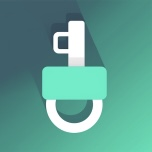

# AppDump

基于 [lara](https://github.com/rooootdev/lara)（DarkSword 内核漏洞工具箱）裁剪出的精简版，**只做一件事：砸壳 + 提取**。

原版功能庞杂（SpringBoard 定制、图标主题、字体覆盖、OTA、ScreenTime、RemoteCall 自定义等等），而本仓库只保留核心两件事：

| 功能 | 说明 |
| - | - |
| **App 解密（砸壳 / FairPlay 解密）** | 沙盒逃逸 + 内核读写，自动拉起目标 App 完成 Damn Vulnerable App 流程 |
| **IPA 提取**（自签 App 直接出包） | 不砸壳，直接拷出原始 bundle 打包 IPA；产物自动弹分享面板 |

> 界面为 4 个 Tab：内核 · 解密 · 文件 · 日志

## 功能概览

### 砸壳流程

1. 内核页点 **Run Exploit（运行漏洞利用**）→ 进度 100%（对勾）
2. 无 offset 时点 **Fetch Kernelcache（获取内核缓存**）或设置里 Import
3. 点 **Initialize System（初始化系统**）→ VFS + SBX 变对勾
4. 切到 **App 解密** Tab → 刷新列表 → 点要砸的 App（自动拉起目标 App 再回来解密）
5. 解压后的 IPA 落在本 App 的 `Documents/Decrypted`，可经分享保存到「文件」App

### IPA 提取（自签 App）

自签（AltStore / ESign / Feather / Sideloadly）App 的 Mach-O 里 `cryptid = 0`，**本身就没加密，不需要砸壳**。列表里这类 App 显示绿色 `Unencrypted` 标签。

- 点绿色对勾 → 直接拷出 `/private/var/containers/Bundle/Application/<UUID>/X.app`，塞进 `Payload/`、打包成 IPA
- 产物落在 `Documents/Extracted/X.ipa`，自动弹分享面板，也能用「文件」App 保存
- 全程**不进内核、不拉起目标 App、无需目标 App 正在运行**，只要 Initialize System 跑过即可，比砸壳流程快很多
- 拷的是原始 bundle（含 `_CodeSignature`、`embedded.mobileprovision`），重签时工具会自动覆盖

### IPA 管理器

- 浏览 `Decrypted` 和 `Extracted` 里的全部 IPA，按更新时间倒序排列，显示大小
- **多选 / 全选 / 删除所选 / 一键清空全部**（带确认弹窗）
- 已生成的 IPA 带蓝色「已生成」徽章，**避免重复砸壳**

## 安装要求

- iOS 16.0+（内核漏洞利用针对 iOS 16+，实测覆盖 16.x ~ 17.x）
- 支持 TrollStore / ESign / AltStore 自签安装
- 需要越狱级别权限（本 App 通过运行时漏洞利用自行挣取，**不需要设备预越狱**）

## 厂商标志与版权

- 本仓库厂商标志为原创设计
- 界面/功能均基于 lara 开源项目重构
- App 内部包含 lara 原作者 rooootdev 等人开发的核心代码，遵循 AGPL-3.0 协议

## 删掉了什么

### 界面 / 功能层（整文件删除或非必须功能移除）

- SpringBoard 图标/背景定制 → 保留为可选项
- Passcode Themes / RootHideManager
- OTA / ScreenTime / RemoteCall 调优
- 及其他 lara 里的非核心模块

### 内核层（编译剔除）

- 未使用的内核扩展
- 非核心 dylib 依赖（保留 darksword-kexploit-fun 所需）

## 自签名 App 的使用注意

- IPA 是未签名的原始文件，需通过 ESign / AltStore 重新签名安装
- 首次安装建议先测试安装，确认沙盒逃逸可用后再砸壳
- 砸壳过程会自动拉起目标 App，**目标 App 必须是可正常打开的 IPA**
- 如果砸壳后 App 重启闪退，尝试删除 App 重装或用其他 IPA 测试

## 贡献

欢迎提交 Issue 和 Pull Request。Issues 模板已按功能/bug/配置分类。

## 致谢

非常感谢 lara 原作者 **rooootdev** 以及社区开发者的贡献，本仓库完全基于开源项目打造。

## License

- UI/代码结构/功能基于 lara 开源协议
- 本仓库自定义部分（界面 UI / 功能组织）不单独分发
- 详细许可信息请参考 [lara](https://github.com/rooootdev/lara) 仓库

## 相关链接

- [lara 官方仓库](https://github.com/rooootdev/lara)
- [DarkSword](https://github.com/DarkSword-Exploit/darksword-kexploit-fun)

---

© AppDump · 2026 · [yAngbin1108](https://github.com/yAngbin1108)
